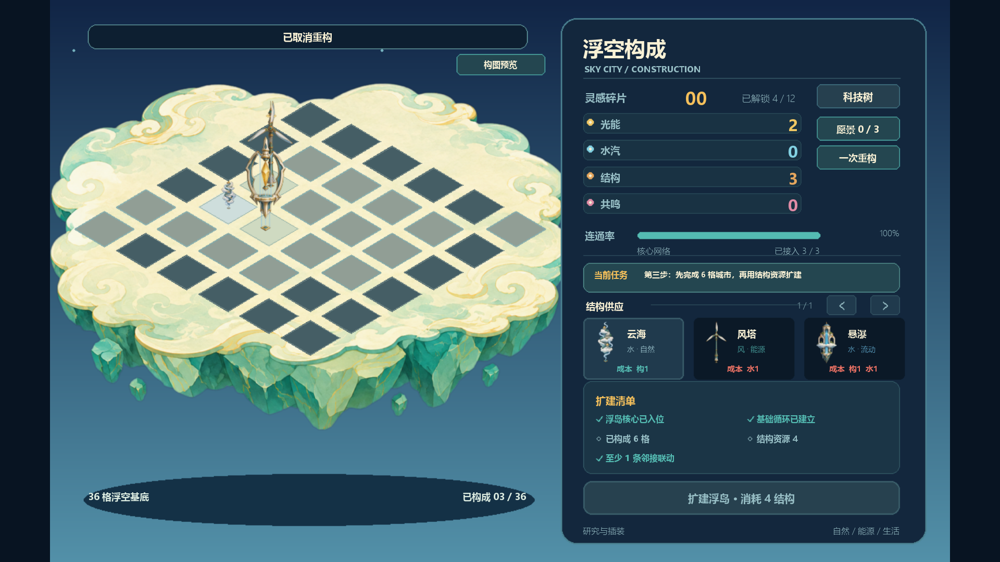
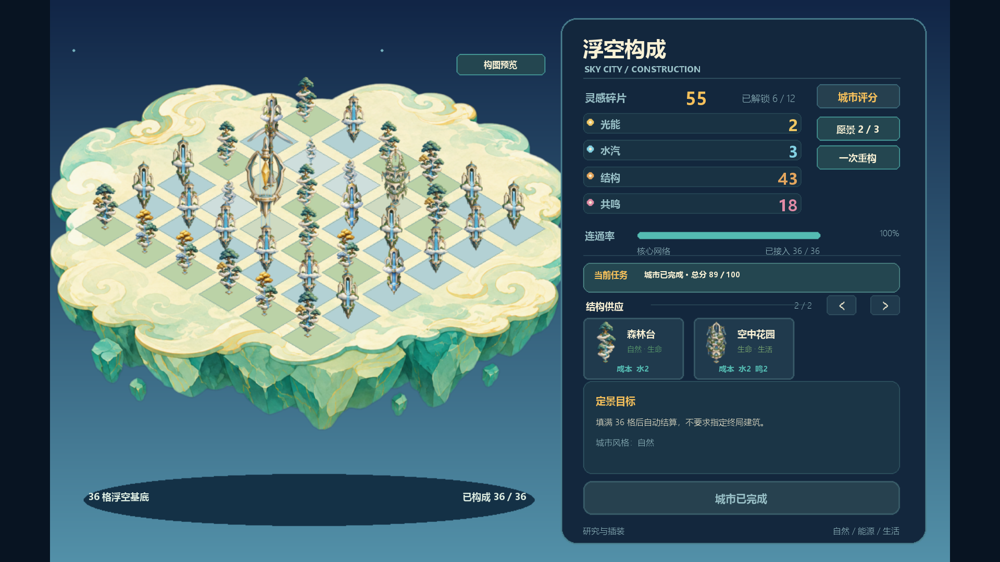

# 天空之城：浮空构成

> 一块菱形浮岛，36 个插槽，12 种建筑。用有限的资源，把自己的天空之城一格一格搭出来。

一个用 **Python + pygame** 写的轻策略构筑小游戏，Windows 全屏运行，单局约 8–12 分钟。
每座建筑既是画面里的形体，也是一个带输入、输出和邻接关系的系统元件：先把生产关系排好，再用有限的空间和资源把城市推向自己想要的形。





## 快速开始

### 方式一：直接玩（推荐给不想装 Python 的人）

到 [Releases](../../releases) 下载 `SkyCityDemo_Setup.exe`，双击安装后从开始菜单或桌面启动即可，无需安装 Python。

### 方式二：从源码运行

需要 Windows 10/11 与 Python 3.9+。

```powershell
git clone https://github.com/<你的用户名>/<仓库名>.git
cd <仓库名>
pip install -r requirements.txt
python game.py
```

也可以直接双击 `run_demo.bat`。

## 操作

| 操作 | 说明 |
| --- | --- |
| 点击结构卡 → 点击亮起的空位 | 插装一次建筑，约 1.8 秒后结算资源 |
| `T` / 右上「科技树」 | 用灵感碎片研究新建筑 |
| `V` / 右上「构图预览」 | 全屏只读城市画卷，按 `S` 导出当前画面 |
| 右键场上建筑 | 拆除并返还部分成本 |
| `R` | 重开一局 |
| `Esc` | 关闭当前界面；在主界面则退出 |

完整操作、路线与评分规则见 [README_DEMO.md](README_DEMO.md)，系统设计细节见 [GAME_DESIGN.md](GAME_DESIGN.md)。

## 玩法要点

- **资源只来自建设事件**：光能、水汽、结构、共鸣由插装结算产生，没有挂机或离线收益。
- **两种路线都能通关**：自然线「云海 → 悬瀑 → 森林台 → 空中花园」和能源线「风塔 → 日晷站 → 齿轮厂 → 云港」都可以独立把城市填满。
- **棋盘逐步开放**：`18 → 26 → 36` 格，扩建需要完成建设清单，而不只是攒够资源。
- **终局评分 100 分**：构成 35 + 网络 30 + 联动 15 + 风格 15 + 愿景 5，结算后自动转入终局画卷。

## 目录结构

```
game.py              主循环、输入、渲染编排
city_rules.py        棋盘分区、位置加成、组合与风格评分
island_art.py        浮岛底板与地形的分层绘制
scene_art.py         终局画卷的场景合成
building_quotes.py   建筑配套题辞
ending_text.py       终局收束文字
generated_assets/    12 类建筑的透明 PNG 立绘（游戏运行必需）
tests/               pygame 冒烟测试与规则测试
build_demo.bat       一键 PyInstaller 打包
make_installer.ps1   生成单文件安装包
```

## 自己打包

```powershell
pip install pyinstaller
build_demo.bat                       # 输出 dist\SkyCityDemo\SkyCityDemo.exe
powershell -NoProfile -File make_installer.ps1   # 输出 dist\SkyCityDemo_Setup.exe
```

## 关于素材

建筑立绘是 AI 生成的透明背景 PNG，存放在 `generated_assets/`；插槽、底板、UI、文字与全部规则线都由程序在原生分辨率绘制，不依赖图片里的文字。

## 说明

- 目前只针对 Windows 全屏（1920×1080）验证，字体取自系统字体目录，其他系统需要自行替换字体路径。
- 这是课程作业性质的原型，代码与素材仅供学习交流，转载或二次使用请先联系作者。

---

A small python/pygame city-building puzzle for Windows. Clone, `pip install -r requirements.txt`, then `python game.py`. A prebuilt installer is available on the Releases page.
